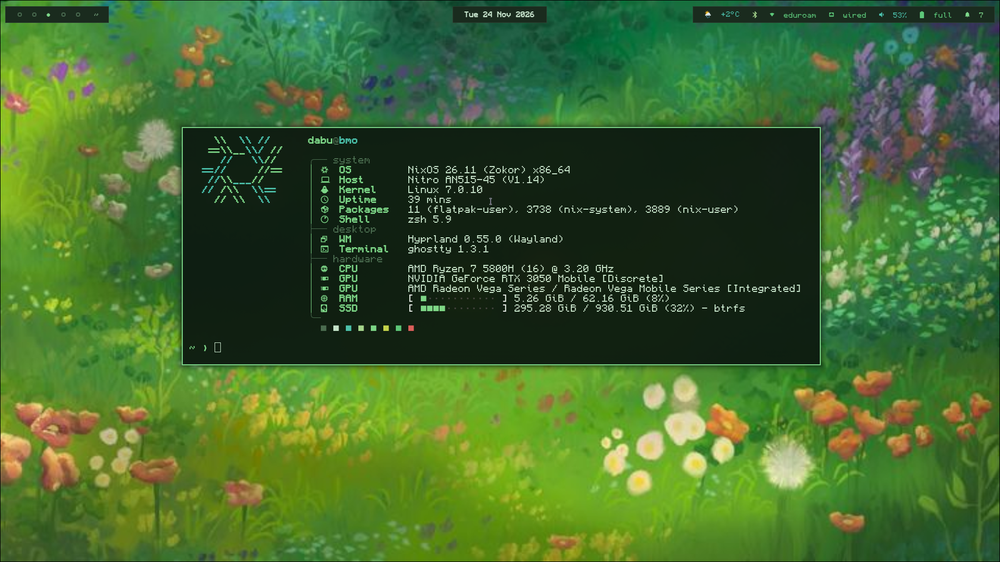
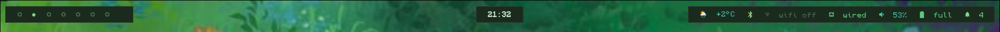
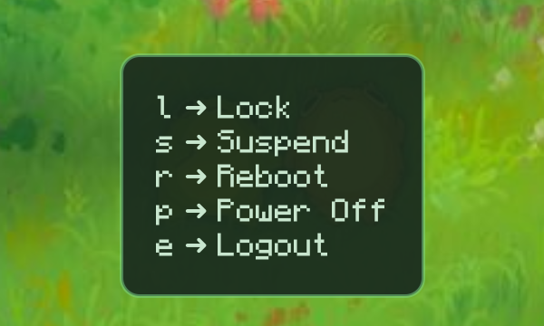
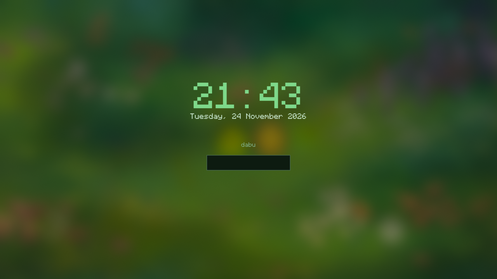
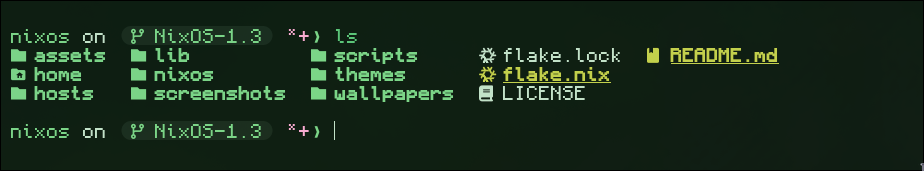

# Froggy NixOS config

NixOS + Home Manager flake running **Hyprland** with waybar, swaync, fuzzel and an
eww dashboard. The same desktop, apps and theme come up on every machine; each
machine only adds its own hardware, GPU and monitor settings. Based on
[nixy](https://github.com/anotherhadi/nixy).

## Features

- **Hyprland** with the config generated by home-manager (Lua), master layout, and a green "nature" theme from stylix: Monocraft font, square corners, one palette everywhere.
- **Waybar**:
  - workspaces, window title and a truly centered clock
  - hover the clock for a big themed calendar (scroll to change month)
  - weather, bluetooth, volume, battery, notifications and tray
  - **Wi-Fi icon** that shows signal strength, "not connected" or "wifi off", plus a separate "wired" indicator when plugged in
  - click the Wi-Fi icon to list nearby networks and connect (asks for the password if needed); right-click turns Wi-Fi on/off
- **eww dashboard** (`Super + D`): music controls with an animated frog, calendar and system stats (CPU, GPU, RAM, SSD).
- **Menus**: `Super + X` power menu (centered), `Super + Shift + A` apps menu. Press the same key again to close them.
- **Lock screen**: hyprlock in the theme colors (`Super + Ctrl + L`), and hypridle locks after 10 minutes idle and before suspend.
- **Fuzzel** launcher, clipboard history, swaync notifications, hyprshot screenshots.
- **Terminal**: Ghostty, zsh with starship, eza, zoxide and a themed fastfetch.
- **Signal** always from a newer nixpkgs (old Signal Desktop versions expire).
- **Same system on every PC**: shared modules in `hosts/common`, one small folder per machine, and `scripts/new-host.sh` to set up a fresh install (see below).

## Screenshots



### Bar



### Dashboard (`Super + D`)


| Music | Calendar | System |
| --- | --- | --- |
|  |  |  |

### Power menu (`Super + X`)



### Lock screen (`Super + Ctrl + L`)



### Terminal



## Install on a new PC

1. Install NixOS normally (create your user during the installer, UEFI/systemd-boot).
2. Clone this repo and create a host for the machine:

   ```sh
   nix-shell -p git
   git clone https://github.com/CodeDaBu/nixos-config ~/.config/nixos
   cd ~/.config/nixos
   ./scripts/new-host.sh <hostname> [username]   # username defaults to dabu
   ```

   The script copies `hosts/_template` to `hosts/<hostname>`, generates the
   hardware config, finds an Nvidia GPU (and the AMD/Intel iGPU) and fills in the PCI
   bus IDs, and `git add`s the new host (flakes only see tracked files).
3. Build it: `sudo nixos-rebuild switch --flake ~/.config/nixos#<hostname>`
   (add `--extra-experimental-features 'nix-command flakes'` the first time).
4. Set a password if the user is new (`sudo passwd <username>`), reboot and pick Hyprland
   in the greeter.

Not in git, so back up/restore it yourself: browser profiles and logins, Signal chats,
SSH keys, Proton logins, Steam games, flatpak data and your files.

## Rebuild

The config lives in `~/.config/nixos`.

```sh
rebuild            # alias for: sudo nixos-rebuild switch --flake ~/.config/nixos#<this host>
```

## Layout

| Path | What's in it |
| --- | --- |
| `flake.nix` | Inputs (nixpkgs unstable, Hyprland, home-manager, stylix, nvf, …); every folder in `hosts/` becomes a `nixosConfigurations.<name>` |
| `hosts/common/` | Everything shared by all machines: `configuration.nix` (system) and `home.nix` (user modules) |
| `hosts/<name>/` | Only what differs per machine: `variables.nix` (hostname, username, locale, GPU bus IDs), `hardware-configuration.nix`, `home.nix` (monitors), `configuration.nix` |
| `hosts/_template/` | Copied by `scripts/new-host.sh` to create a new host |
| `lib/mk-host.nix` | Builds a host (same modules for every machine) |
| `scripts/new-host.sh` | Creates a host for the machine you are on |
| `assets/` | Profile picture |
| `nixos/` | System modules: `hyprland.nix`, `nvidia.nix`, audio, bluetooth, fonts, boot, greeter, steam, … |
| `home/system/` | Desktop: `hyprland/` (generates `hyprland.lua` via home-manager: settings, keybinds, animations), `waybar`, `swaync`, `fuzzel`, `eww` (dashboard), `hyprpaper` |
| `home/programs/` | User programs: ghostty, nvf (neovim), shell (zsh), git, helium, yazi, thunar, app groups |
| `themes/nixy.nix` | Stylix theme: green "nature" base16 scheme, Monocraft font, gaps/rounding/opacity |
| `wallpapers/` | `nature.jpg` (used by stylix + hyprpaper) |

## Keybinds

`Super` = mod.

| Keys | Action |
| --- | --- |
| `Super + Return` | Ghostty terminal |
| `Super + E` | Thunar |
| `Super + B` | Helium browser |
| `Super + Space` | Fuzzel launcher (press again to close) |
| `Super + D` | eww dashboard on the focused monitor (toggle / move) |
| `Super + V` | Clipboard history |
| `Super + Q` | Close the dashboard if open, otherwise close the window |
| `Super + F` / `Super + Shift + F` | Fullscreen / toggle floating |
| `Super + H J K L` | Move focus |
| `Super + Shift + H / L` | Focus previous / next monitor |
| `Super + 1–9` / `Super + Shift + 1–9` | Go to / move window to workspace |
| `Super + X` | Power menu (lock, suspend, reboot, power off, logout); press again to close |
| `Super + Ctrl + L` | Lock the screen |
| `Super + Shift + A` | Apps menu (Proton apps, Obsidian, Signal, TickTick, …); press again to close |
| `Super + Shift + S` / `Print` | Screenshot region / screen |

## GPU (PRIME offload)

`nixos/nvidia.nix` is only imported by hosts with an Nvidia GPU. On a hybrid laptop it
renders on the AMD/Intel iGPU and offloads to Nvidia. The bus IDs **must** match the
hardware or Hyprland won't start. They live in `hosts/<name>/variables.nix`
(`new-host.sh` fills them in for you):

```nix
gpu = {
  nvidiaBusId = "PCI:1:0:0"; # lspci: 01:00.0
  amdgpuBusId = "PCI:5:0:0"; # lspci: 05:00.0 (or intelBusId for an Intel iGPU)
};
```

Check them with `lspci | grep -Ei "vga|3d|display"`. lspci prints hex
(`05:00.0`); NixOS wants decimal `PCI:bus:device:function`. A desktop with only an
Nvidia card leaves out the iGPU ID and gets no PRIME setup.
