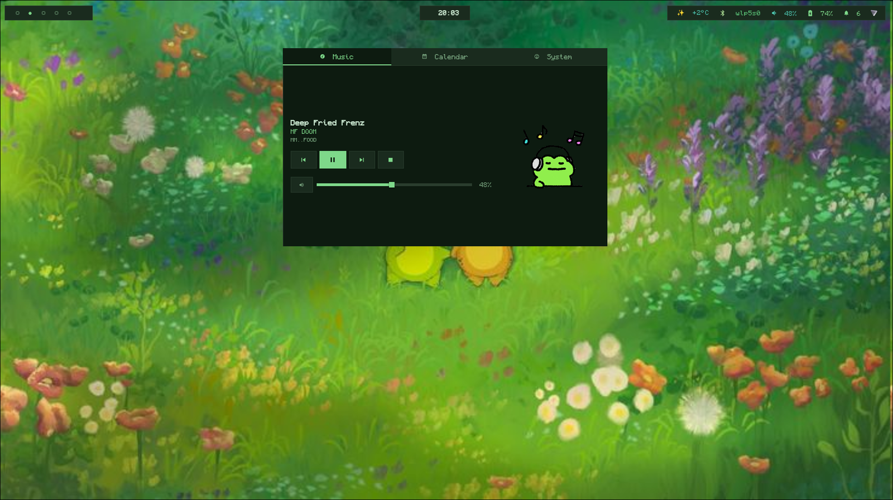
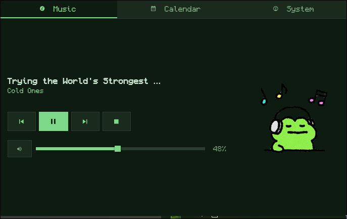
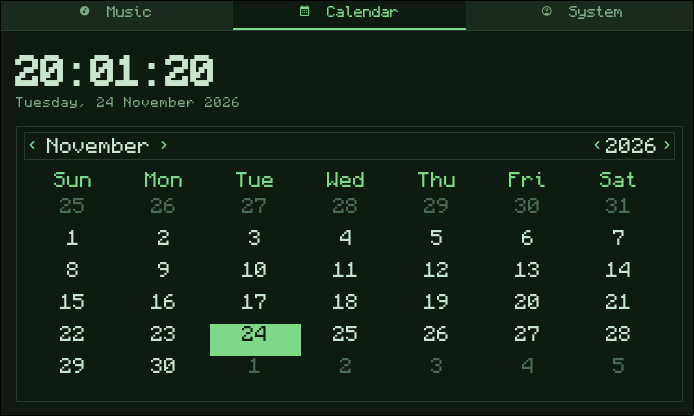
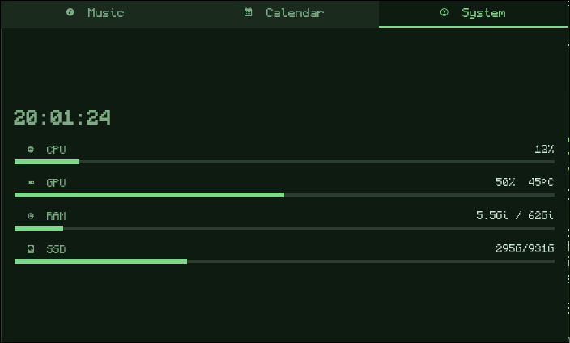

# BMO NixOS config

NixOS + Home Manager flake for **bmo** (HP laptop, AMD iGPU + Nvidia dGPU) running
**Hyprland** with waybar, swaync, fuzzel and an eww dashboard. Based on
[nixy](https://github.com/anotherhadi/nixy), trimmed down to a single host.

## Screenshots



The dashboard (`Super + D`) has three tabs:

| Music | Calendar | System |
| --- | --- | --- |
|  |  |  |

## Rebuild

The config lives in `~/.config/nixos` on the laptop.

```sh
rebuild            # alias for: sudo nixos-rebuild switch --flake ~/.config/nixos#bmo
```

## Layout

| Path | What's in it |
| --- | --- |
| `flake.nix` | Inputs (nixpkgs unstable, Hyprland, home-manager, stylix, nvf, …) and the `bmo` output |
| `hosts/bmo/` | Host config: `configuration.nix` (system), `home.nix` (user), `variables.nix` (username, locale, keyboard), `my-apps.nix` (personal packages), hardware config |
| `nixos/` | System modules: `hyprland.nix`, `nvidia.nix`, audio, bluetooth, fonts, boot, greeter, steam, … |
| `home/system/` | Desktop: `hyprland/` (settings, keybinds, animations), `waybar`, `swaync`, `fuzzel`, `eww` (dashboard), `hyprpaper` |
| `home/programs/` | User programs: ghostty, nvf (neovim), shell (zsh), git, helium, yazi, thunar, app groups |
| `themes/nixy.nix` | Stylix theme: green "nature" base16 scheme, Monocraft font, gaps/rounding/opacity |
| `wallpapers/` | `nature.jpg` (used by stylix + hyprpaper) |

## Keybinds

`Super` = mod.

| Keys | Action |
| --- | --- |
| `Super + Return` | Ghostty terminal |
| `Super + E` | Thunar |
| `Super + B` | Helium browser |
| `Super + Space` | Fuzzel launcher (press again to close) |
| `Super + D` | eww dashboard on the focused monitor (toggle / move) |
| `Super + V` | Clipboard history |
| `Super + Q` | Close the dashboard if open, otherwise close the window |
| `Super + F` / `Super + Shift + F` | Fullscreen / toggle floating |
| `Super + H J K L` | Move focus |
| `Super + Shift + H / L` | Focus previous / next monitor |
| `Super + 1–9` / `Super + Shift + 1–9` | Go to / move window to workspace |
| `Super + X` | Power menu (lock, suspend, reboot, power off, logout) |
| `Super + Shift + A` | Apps menu (Proton apps, Obsidian, Signal, TickTick, …) |
| `Super + Shift + S` / `Print` | Screenshot region / screen |

## GPU (PRIME offload)

`nixos/nvidia.nix` runs the AMD iGPU as primary and offloads to Nvidia.
The bus IDs **must** match the hardware or Hyprland won't start:

```nix
amdgpuBusId = "PCI:5:0:0"; # AMD iGPU  (lspci: 05:00.0)
nvidiaBusId = "PCI:1:0:0"; # Nvidia    (lspci: 01:00.0)
```

Check them with `lspci | grep -Ei "vga|3d|display"`. lspci prints hex
(`05:00.0`); NixOS wants decimal `PCI:bus:device:function`.

## Changelog

### 2026-11-24 — Hyprland fix (commit `5637b17`)

Hyprland stopped starting after the 23.11 changes. Cause: the cleanup commit
`50d37bf` changed `amdgpuBusId` in `nixos/nvidia.nix` from `PCI:5:0:0` to
`PCI:6:0:0`. The iGPU on this laptop is at `05:00.0` (its USB controllers are
`05:00.3` / `05:00.4`, see the usbguard rules in `hosts/bmo/configuration.nix`),
so the wrong ID broke PRIME and Hyprland. **Only that one line was changed back.**
Nothing else from 23.11 was touched; flake inputs were not updated.

> If you have local commits on the laptop that aren't pushed yet, run
> `git pull --rebase` before pushing so they sit on top of this fix.

### 2026-11-23

- Removed other hosts, server modules and the caelestia-shell; added steam, flatpak
- New desktop: waybar, swaync sidebar, fuzzel, eww dashboard (music / calendar / system tabs)
- Green "nature" theme, Monocraft font, square corners (`rounding = 0`)
- Keybinds rewritten for the new tools (see table above)
